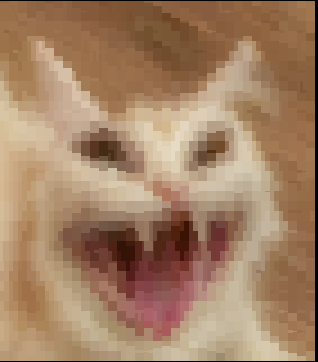
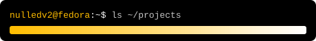

<table border="0">
  <tr>
    <td valign="top"></td>
    <td valign="top">
      

      <a href="https://github.com/NulledNah/LightMCP"><b>LightMCP</b></a> — local LLM-powered semantic tool router for MCP 
      <a href="https://github.com/NulledNah/PcRemote"><b>PcRemote</b></a> — use your phone as a full PC remote 
      <a href="https://github.com/NulledNah/FastDownload"><b>FastDownload</b></a> — audio → FL Studio project folder (VST3 + desktop) 
      <a href="https://github.com/NulledNah/FileCompactor"><b>FileCompactor</b></a> — multi-codec adaptive compressor in Zig (beats xz at 4.03×) 
      <a href="https://github.com/NulledNah/DeepSeekPanel"><b>DeepSeekPanel</b></a> — DeepSeek usage panel for the OpenCode desktop app 
      <a href="https://github.com/NulledNah/FreelancerSync"><b>FreelancerSync</b></a> — Freelancer bid-sync button for OpenCode 
      <a href="https://github.com/NulledNah/E_ASM"><b>E_ASM</b></a> — x86 production scheduler · UniVR lab 
       
      <code>stack</code> python · typescript · javascript · assembly · zig
    </td>
  </tr>
</table>
