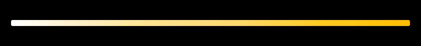

<picture><source media="(max-width:700px)" srcset="https://raw.githubusercontent.com/NulledNah/NulledNah/main/assets/view-mobile.1ca2aba0.svg"></picture>
<picture><source media="(max-width:700px)" srcset="https://raw.githubusercontent.com/NulledNah/NulledNah/main/assets/view-empty.ba7087a0.svg"></picture>
<a href="https://www.univr.it/"><picture><source media="(max-width:700px)" srcset="https://raw.githubusercontent.com/NulledNah/NulledNah/main/assets/view-empty.ba7087a0.svg"></picture></a>
<picture><source media="(max-width:700px)" srcset="https://raw.githubusercontent.com/NulledNah/NulledNah/main/assets/view-empty.ba7087a0.svg"></picture>
<picture><source media="(max-width:700px)" srcset="https://raw.githubusercontent.com/NulledNah/NulledNah/main/assets/view-empty.ba7087a0.svg"></picture>
<a href="https://github.com/NulledNah?tab=repositories"><picture><source media="(max-width:700px)" srcset="https://raw.githubusercontent.com/NulledNah/NulledNah/main/assets/view-empty.ba7087a0.svg"></picture></a>
<a href="https://github.com/NulledNah/PcRemote"><picture><source media="(max-width:700px)" srcset="https://raw.githubusercontent.com/NulledNah/NulledNah/main/assets/view-empty.ba7087a0.svg"></picture></a>
<a href="https://github.com/NulledNah/LightMCP"><picture><source media="(max-width:700px)" srcset="https://raw.githubusercontent.com/NulledNah/NulledNah/main/assets/view-empty.ba7087a0.svg"></picture></a>
<a href="https://github.com/NulledNah/FastDownload"><picture><source media="(max-width:700px)" srcset="https://raw.githubusercontent.com/NulledNah/NulledNah/main/assets/view-empty.ba7087a0.svg"></picture></a>
<a href="https://github.com/NulledNah/FileCompactor"><picture><source media="(max-width:700px)" srcset="https://raw.githubusercontent.com/NulledNah/NulledNah/main/assets/view-empty.ba7087a0.svg"></picture></a>
<a href="https://github.com/NulledNah?tab=repositories&q=topic:opencode-plugin"><picture><source media="(max-width:700px)" srcset="https://raw.githubusercontent.com/NulledNah/NulledNah/main/assets/view-empty.ba7087a0.svg"></picture></a>
<a href="https://github.com/NulledNah/CapriPanel"><picture><source media="(max-width:700px)" srcset="https://raw.githubusercontent.com/NulledNah/NulledNah/main/assets/view-empty.ba7087a0.svg"></picture></a>
<a href="https://github.com/NulledNah/DeepSeekPanel"><picture><source media="(max-width:700px)" srcset="https://raw.githubusercontent.com/NulledNah/NulledNah/main/assets/view-empty.ba7087a0.svg"></picture></a>
<a href="https://github.com/NulledNah/FreelancerSync"><picture><source media="(max-width:700px)" srcset="https://raw.githubusercontent.com/NulledNah/NulledNah/main/assets/view-empty.ba7087a0.svg"></picture></a>
<a href="https://github.com/NulledNah/SkillsTab"><picture><source media="(max-width:700px)" srcset="https://raw.githubusercontent.com/NulledNah/NulledNah/main/assets/view-empty.ba7087a0.svg"></picture></a>
<picture><source media="(max-width:700px)" srcset="https://raw.githubusercontent.com/NulledNah/NulledNah/main/assets/view-empty.ba7087a0.svg"></picture>
<a href="https://github.com/NulledNah/E_ASM"><picture><source media="(max-width:700px)" srcset="https://raw.githubusercontent.com/NulledNah/NulledNah/main/assets/view-empty.ba7087a0.svg"></picture></a>
<a href="https://github.com/morelli03/progetto-ingegneria"><picture><source media="(max-width:700px)" srcset="https://raw.githubusercontent.com/NulledNah/NulledNah/main/assets/view-empty.ba7087a0.svg"></picture></a>
<picture><source media="(max-width:700px)" srcset="https://raw.githubusercontent.com/NulledNah/NulledNah/main/assets/view-empty.ba7087a0.svg"></picture>
